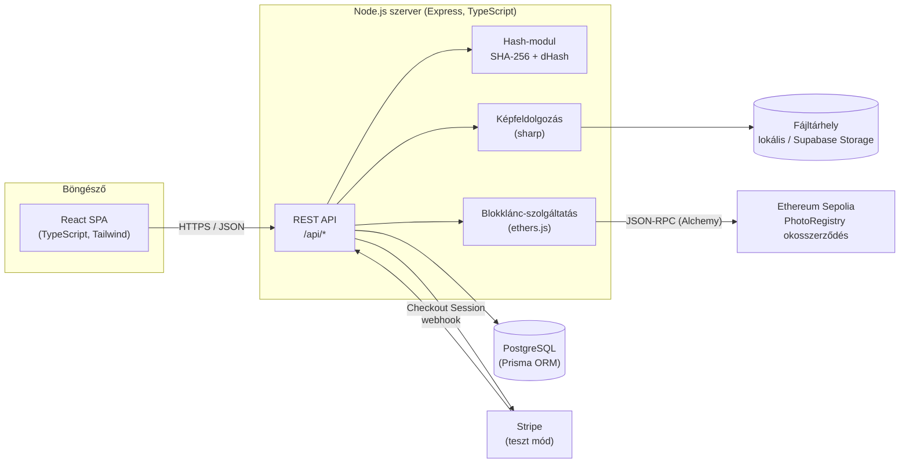
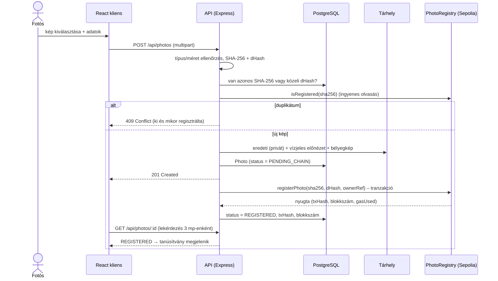
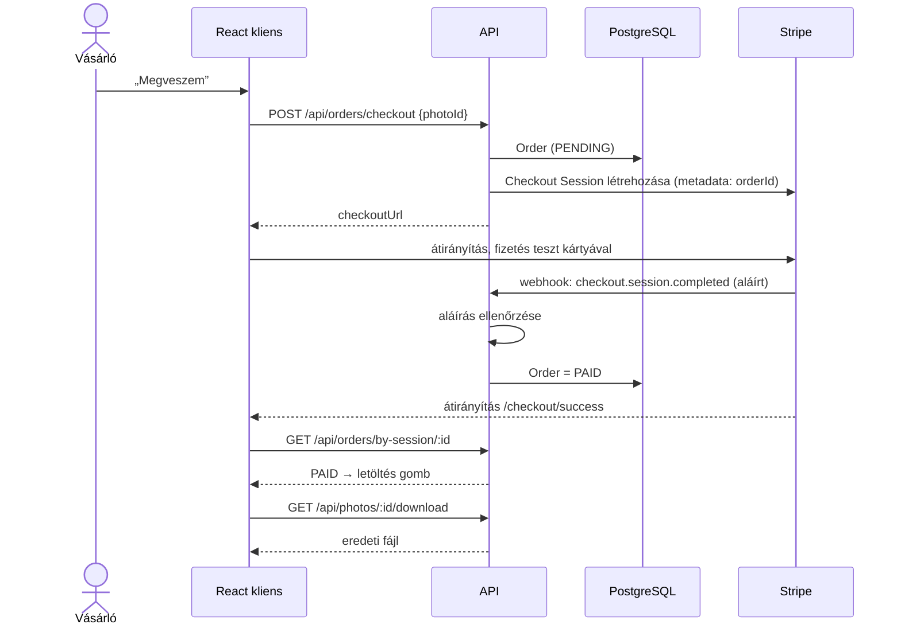
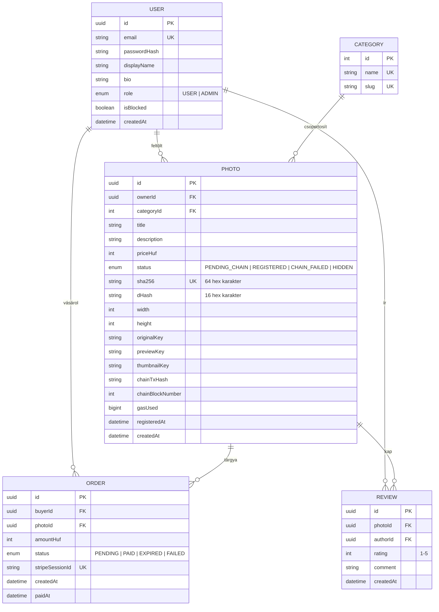

# Fejlesztési terv – Blokklánc-alapú hitelesítéssel működő fotó-marketplace

> **Projektnév:** *PhotoChain* (GitHub: `klaus3577/PhotoChain`, privát)
> **Cél:** demonstrációs célú webes marketplace-prototípus, ahol a felhasználók saját fotóikat tölthetik fel eladásra, és a rendszer a feltöltött képek hash-értékét egy Ethereum okosszerződésben rögzíti, így ugyanaz a kép (vagy annak módosított másolata) nem tölthető fel még egyszer jogosulatlanul.
> **Dokumentum verzió:** 1.3 – 2026-10-15 (L33: az 5. fejezet a megvalósított API-hoz igazítva, a 13. fejezet kitöltve; 1.2 – 2026-09-28: projektnév PhotoChain, a projekt helye: `D:\szakdolgozat\CodeBase`)

---

## 0. Hogyan használd ezt a dokumentumot

- A fejlesztés **8 fázisra (F0–F7)** és **33 lépésre (L01–L33)** van bontva. Egy lépés = egy jól körülhatárolt munkadarab = **egy alfejezet** a dolgozat „Megvalósítás” részében.
- Minden lépésnél szerepel:
  - **Cél** – mit ad hozzá a rendszerhez
  - **Feladatok** – mit kell elkészíteni
  - **Fájlok** – mely fájlok jönnek létre / változnak (lásd 6. fejezet)
  - **Kész, ha** – ellenőrizhető elkészülési feltétel (a témavezetőnek is ez mutatható)
  - **📸 Képernyőkép** – mit érdemes lefotózni a dolgozatba
  - **📚 Források** – a 12. fejezet forrásaira mutató [Sx] hivatkozások
  - **Méret** – S (kicsi) / M (közepes) / L (nagy, akár két munkamenetre bontható)
- A képernyőképek elnevezése: `docs/screenshots/L10_02_duplikacio_409.png` (lépés_sorszám_rövid_leírás).
- Minden lépés után: rövid bejegyzés a `docs/fejlesztesi-naplo.md`-be + egy git commit (`feat(L10): ...`).

---

## 1. A rendszer áttekintése

### 1.1 Szereplők

| Szereplő | Leírás |
|---|---|
| **Vendég** | Böngészi a galériát, megnézi a képek hitelesítési adatait, használja a nyilvános hitelesség-ellenőrzőt. |
| **Regisztrált felhasználó** | Fotósként képeket tölt fel és árul, vásárlóként képeket vesz, letölt és értékel. (Egy fiók mindkét szerepet betöltheti.) |
| **Adminisztrátor** | Felhasználókat tilthat, képeket rejthet el, a sikertelen blokklánc-regisztrációkat újrapróbálhatja, statisztikákat lát. |
| **Külső rendszerek** | Ethereum Sepolia teszthálózat (okosszerződés), Stripe (fizetés), fájltárhely. |

### 1.2 Funkcionális követelmények (MVP)

1. Regisztráció, bejelentkezés, kijelentkezés, profil szerkesztése.
2. Fotó feltöltése címmel, leírással, árral, kategóriával.
3. **Feltöltéskori hitelesítés:** SHA-256 és perceptuális (dHash) hash számítása, duplikáció-ellenőrzés (adatbázis + blokklánc), új kép esetén a hash rögzítése az okosszerződésben.
4. Vízjeles, csökkentett felbontású előnézet; az eredeti fájl csak a tulajdonosnak és a vásárlónak érhető el.
5. Galéria keresővel, kategória- és árszűrővel, rendezéssel, lapozással.
6. Fotó adatlap „blokklánc-tanúsítvánnyal” (hash, regisztráció ideje, tranzakció linkje az Etherscanen).
7. **Nyilvános hitelesség-ellenőrző:** bárki feltölthet egy képet, és megtudja, hogy regisztrált eredeti-e, hasonlít-e egy regisztrált képre, vagy ismeretlen.
8. Vásárlás Stripe Checkouttal (teszt mód), vásárlás után eredeti letöltése.
9. Értékelés (1–5 csillag + szöveg) – csak a képet megvásárló felhasználótól.
10. Admin felület.

### 1.3 Nem funkcionális követelmények

- **Biztonság:** jelszavak hash-elve, JWT httpOnly sütiben, jogosultság-ellenőrzés minden védett végponton, fájlfeltöltés validálása, rate limiting, titkos kulcsok csak környezeti változóban.
- **Adatvédelem:** a blokkláncra nem kerül személyes adat (csak hash-ek és álnevesített tulajdonos-azonosító); az előnézetekből az EXIF/GPS metaadat törlődik.
- **Használhatóság:** reszponzív (mobil + asztali), érthető hibaüzenetek, WCAG AA kontraszt.
- **Karbantarthatóság:** TypeScript mindenhol, rétegzett backend, automatizált tesztek (cél: ≥ 80% lefedettség a szerver üzleti logikáján).
- **Hordozhatóság:** Docker-konténerben futtatható, felhőbe élesíthető.

### 1.4 A hitelesítési mechanizmus röviden

1. A feltöltött fájlból két ujjlenyomat készül:
   - **SHA-256** a fájl bájtjaiból – *bájtpontos* egyezést ismer fel [S39].
   - **dHash** (különbség-hash, 64 bit) a kép pixeleiből – *vizuálisan azonos, de módosított* (átméretezett, újratömörített, formátumváltott) másolatokat is felismer [S40–S42].
2. Ellenőrzés: van-e ugyanilyen SHA-256 az adatbázisban vagy a láncon, illetve van-e olyan dHash, amelynek **Hamming-távolsága** [S43] a küszöb alatt van → ha igen: elutasítás (HTTP 409).
3. Ha a kép új: a szerver a platform-tárcával tranzakciót küld a `PhotoRegistry` okosszerződésnek, amely a láncon rögzíti: `SHA-256 → (tulajdonos-azonosító, dHash, időbélyeg)`. Ugyanaz a hash másodszor nem regisztrálható (a szerződés visszautasítja).
4. A tranzakció hash-e és blokkszáma az adatbázisba kerül; az adatlapon bárki ellenőrizheti az Etherscanen.

> **A dolgozatban tárgyalandó korlátok:** a tükrözés, forgatás és erős vágás megtévesztheti a dHash-t; a rendszer „aki elsőként regisztrál” elven működik (egy lopott képet is regisztrálhat elsőként a tolvaj); a védelem a platformon belül érvényes. Továbbfejlesztési irány: C2PA / Content Credentials [S48], felhasználói tárcával aláírt regisztráció, vitarendezési folyamat.

---

## 2. Technológiák és fejlesztői környezet

### 2.1 Technológiai stack

| Réteg | Technológia | Nyelv | Indoklás (a dolgozatba) |
|---|---|---|---|
| Frontend | **React** + **Vite** | TypeScript (TSX) | Komponensalapú, legelterjedtebb UI-könyvtár; Vite gyors fejlesztői szerver és build. |
| Stílus | **Tailwind CSS** | CSS | Utility-osztályok → gyors, konzisztens, reszponzív design. |
| Útválasztás, adatlekérés | **React Router**, **TanStack Query** | TypeScript | Kliensoldali oldalak; szerverállapot gyorsítótárazása, betöltési/hibaállapotok. |
| Backend | **Node.js 24 LTS** + **Express 5** | TypeScript | Ugyanaz a nyelv frontenden és backenden; nagy ökoszisztéma. |
| Validáció | **Zod** | TypeScript | Sémaalapú bemenet-validálás a rendszerhatáron. |
| Adatbázis | **PostgreSQL 17** | SQL | Relációs adatok (felhasználók, rendelések, értékelések), tranzakciók, egyedi megszorítások. |
| ORM | **Prisma** | Prisma séma (+ generált SQL) | Típusbiztos lekérdezések, verziózott migrációk. |
| Képfeldolgozás | **sharp** | TypeScript | Gyors (libvips): átméretezés, vízjel, pixeladat a dHash-hez. |
| Okosszerződés | **Solidity 0.8.x** + **OpenZeppelin Contracts** | Solidity | Ethereum-szabvány; auditált `Ownable` hozzáférés-kezelés. |
| Szerződésfejlesztés | **Hardhat 3** (+ Ignition) | TypeScript | Tesztelés, deploy, Etherscan-verifikáció. |
| Blokklánc-hálózat | **Ethereum Sepolia** testnet | – | Ingyenes, nyilvános, Etherscanen ellenőrizhető; fejlesztéshez lokális Hardhat-hálózat. |
| Lánc-kliens | **ethers.js v6** + **Alchemy** RPC | TypeScript | Tranzakciók küldése és olvasása a backendből. |
| Fizetés | **Stripe Checkout** (teszt mód) | TypeScript | Hosztolt fizetőoldal → a kártyaadat nem érinti a szervert. |
| Hitelesítés | **JWT** (httpOnly süti) + **bcrypt** | TypeScript | Állapotmentes munkamenet, XSS-ellen védettebb, mint a localStorage. |
| Tesztelés | **Vitest**, **Supertest**, **React Testing Library**, **Playwright**, Hardhat test | TypeScript | Unit, integrációs és E2E tesztek. |
| Konténerizálás | **Docker**, **Docker Compose** | Dockerfile, YAML | Reprodukálható környezet, egyszerű élesítés. |
| Élesítés | **Render** (alkalmazás) + **Supabase** (PostgreSQL + fájltár) | – | Ingyenes kerettel elérhető, a témavezető online kipróbálhatja. |
| Verziókezelés | **Git** + **GitHub** | – | Lépésenkénti commitok = a haladás bizonyítéka. |

> A pontos verziószámokat a telepítéskor a `package.json` fájlok rögzítik – a dolgozatba ezeket írd be, ne a fentieket.

### 2.2 Kellenek-e ezek a nyelvek?

| Nyelv / technológia | Kell? | Hol és mire |
|---|---|---|
| **TypeScript** | **Igen – fő nyelv** | Frontend, backend, tesztek, Hardhat scriptek. |
| **JavaScript** | Közvetve | A TypeScript JavaScriptre fordul; kézzel `.js` fájlt legfeljebb egy-egy konfigurációnál írunk. A JS alapjainak ismerete viszont kell. |
| **React** | **Igen** | A teljes felhasználói felület (TSX komponensek). |
| **HTML** | Igen, de keveset | Egyetlen `index.html`; a React JSX szintaxisa HTML-szerű, ezért a szemantikus HTML-elemek ismerete kell. |
| **CSS** | **Igen** | Tailwind CSS osztályok + egy globális `index.css`. |
| **Solidity** | **Igen** | A `PhotoRegistry` okosszerződés. |
| **SQL** | Közvetve | A Prisma sémából generált migrációk SQL-ek; a dolgozatban az adatmodell magyarázatához kell. |
| **Node.js** | Futtatókörnyezet | A backend és a fejlesztői eszközök futtatása. |
| **YAML / JSON** | Konfiguráció | `docker-compose.yml`, CI, `package.json`, `tsconfig.json`. |
| **Dockerfile** | Igen (F7) | Konténerkép építése. |
| **PowerShell / Bash** | Parancssor | npm-, git-, docker-parancsok futtatása. |

### 2.3 Telepítendő szoftverek (L01)

| Szoftver | Mire kell | Ellenőrzés |
|---|---|---|
| **Node.js 24 LTS** (npm-mel) | Frontend, backend, Hardhat | `node -v`, `npm -v` |
| **Git** | Verziókezelés | `git --version` |
| **Visual Studio Code** | Fejlesztői környezet | – |
| **Docker Desktop** (WSL 2 háttérrel) | PostgreSQL fejlesztéshez, később a teljes stack | `docker --version`, `docker compose version` |
| **Stripe CLI** | Webhookok továbbítása a helyi gépre | `stripe --version` |
| **Google Chrome** (+ opcionálisan MetaMask) | Tesztelés, DevTools, testnet-tárca megtekintése | – |

### 2.4 VS Code bővítmények (`.vscode/extensions.json`-ba is bekerülnek)

| Bővítmény | Azonosító | Mire |
|---|---|---|
| ESLint | `dbaeumer.vscode-eslint` | Kódhibák jelzése |
| Prettier | `esbenp.prettier-vscode` | Egységes formázás |
| Prisma | `Prisma.prisma` | Séma szintaxiskiemelés |
| Tailwind CSS IntelliSense | `bradlc.vscode-tailwindcss` | Osztálynév-kiegészítés |
| Solidity (Nomic Foundation) | `NomicFoundation.hardhat-solidity` | Solidity szerkesztés |
| Docker | `ms-azuretools.vscode-docker` | Konténerek kezelése |
| REST Client | `humao.rest-client` | `.http` fájlokból API-kérések (jól screenshotolható!) |
| Vitest | `vitest.explorer` | Tesztek futtatása a szerkesztőből |
| Playwright Test | `ms-playwright.playwright` | E2E tesztek |
| Markdown Preview Mermaid | `bierner.markdown-mermaid` | A diagramok megjelenítése a Markdownban |
| GitLens *(opcionális)* | `eamodio.gitlens` | Git-előzmények |
| Error Lens *(opcionális)* | `usernamehw.errorlens` | Hibák soron belül |

### 2.5 Szükséges (ingyenes) fiókok

- **GitHub** – privát repository (a témavezető meghívható olvasóként).
- **Alchemy** (vagy Infura) – Sepolia RPC végpont.
- **Stripe** – teszt módú kulcsok.
- **Etherscan** – API-kulcs a szerződés forráskódjának verifikálásához.
- **Supabase** és **Render** – csak az F7 fázisban.
- **Figma** *(opcionális)* – drótvázak (L17).

> **Elérési út:** a projekt gyökere `D:\szakdolgozat\CodeBase` – rövid, szóköz és ékezet nélküli útvonal, így a Docker bind mountok és az npm scriptek sem okoznak gondot. A VS Code-ot mindig ebben a mappában nyisd meg (itt lesz a git repository gyökere is). A dolgozat Word-fájljai eggyel feljebb, a `D:\szakdolgozat` mappában vannak, a repositoryn kívül.

---

## 3. Architektúra és tervezési döntések

### 3.1 Rendszerarchitektúra



### 3.2 Feltöltés és hitelesítés (szekvenciadiagram)



### 3.3 Vásárlás (szekvenciadiagram)



### 3.4 Tervezési döntések (a dolgozat „Rendszerterv” fejezetéhez)

| # | Döntés | Indoklás | Elvetett alternatíva |
|---|---|---|---|
| D1 | Három különálló alprojekt: `client/`, `server/`, `blockchain/` | Tiszta rétegek, külön dokumentálhatók és tesztelhetők | Egyetlen Next.js projekt |
| D2 | REST API + SPA; élesben az Express szolgálja ki a lefordított klienst is | Egy origin → nincs CORS- és sütiprobléma, egy konténer | Külön frontend-hosting |
| D3 | Rétegzett backend: route → controller → service → Prisma | Felelősségek szétválasztása, tesztelhetőség | Minden logika a route-okban |
| D4 | JWT httpOnly, `SameSite=Lax` sütiben | JavaScriptből nem olvasható → XSS ellen védettebb | Token a localStorage-ban |
| D5 | A láncra a **platform-tárca** ír (a szerver írja alá a tranzakciót) | A felhasználóknak nem kell kriptotárca és ETH → jobb UX | Felhasználói MetaMask-aláírás (továbbfejlesztési irány) |
| D6 | A láncra csak hash kerül, a kép és a személyes adat nem | Költség, adatvédelem (a blokklánc nem törölhető – GDPR [S49]) | Kép IPFS-re / láncra |
| D7 | Kettős hash: SHA-256 (láncon kulcs) + dHash (hasonlóság) | A SHA-256 egy bájt változására is teljesen megváltozik; a dHash robusztus a kis módosításokra | Csak SHA-256 |
| D8 | Sepolia testnet élesben, lokális Hardhat-hálózat fejlesztéshez/teszthez | Ingyenes, nyilvánosan ellenőrizhető; lokálisan gyors és determinisztikus | Ethereum mainnet (valódi költség) |
| D9 | Stripe hosztolt Checkout + webhook | A kártyaadat nem érinti a szervert; a fizetés tényét aláírt webhook igazolja | Saját kártyaűrlap |
| D10 | Vízjeles előnézet publikus, eredeti privát | A marketplace maga se legyen „lopási forrás” | Eredeti publikus URL-lel |
| D11 | Tárhely-absztrakció (`StorageService`): lokális lemez ↔ Supabase Storage | Fejlesztés internet nélkül, élesben felhő | Közvetlenül felhőbe írni mindig |
| D12 | A lánc-regisztráció a feltöltési kérés után, háttérben fut | A kérés nem vár 15–30 másodpercet a blokkra; állapot: `PENDING_CHAIN → REGISTERED` | Szinkron várakozás |

---

## 4. Adatmodell



- `REVIEW`: egyedi megszorítás `(photoId, authorId)` – egy felhasználó egy képet egyszer értékelhet.
- A „megvásárolt licenc” külön tábla nélkül: egy `PAID` állapotú `ORDER` jogosít fel a letöltésre.

### 4.1 Az okosszerződés interfésze (`PhotoRegistry.sol`)

```text
struct PhotoRecord { bytes32 ownerRef; bytes8 perceptualHash; uint64 registeredAt; }

registerPhoto(bytes32 contentHash, bytes8 perceptualHash, bytes32 ownerRef)  – csak a platform (onlyOwner)
isRegistered(bytes32 contentHash) → bool                                      – view, ingyenes
getRecord(bytes32 contentHash) → PhotoRecord                                  – view, ingyenes

event PhotoRegistered(bytes32 indexed contentHash, bytes32 indexed ownerRef, bytes8 perceptualHash, uint64 registeredAt)
error AlreadyRegistered(bytes32 contentHash)
```

`ownerRef = keccak256(userId)` – álnevesített azonosító, a láncon nincs név vagy e-mail.

---

## 5. API-végpontok és oldaltérkép

### 5.1 REST API (`/api`)

| Metódus | Útvonal | Jogosultság | Leírás | Lépés |
|---|---|---|---|---|
| GET | `/health` | – | Állapotellenőrzés | L06 |
| POST | `/auth/register` | – | Regisztráció | L08 |
| POST | `/auth/login` | – | Bejelentkezés (süti beállítása) | L08 |
| POST | `/auth/logout` | – | Kijelentkezés | L08 |
| GET | `/auth/me` | – | Saját adatok; munkamenet nélkül is 200, `user: null` (L26) | L08 |
| POST | `/photos` | bejelentkezett | Feltöltés + hitelesítés | L10–L11 |
| GET | `/photos` | – | Lista: `q`, `categoryId`, `ownerId`, `minPrice`, `maxPrice`, `sort` (`newest` / `oldest` / `price_asc` / `price_desc`), `page`, `pageSize` ≤ 50 | L13 |
| GET | `/photos/:id` | – (a nem nyilvános képet csak a tulajdonos és az admin látja) | Adatlap + tanúsítvány | L13 |
| PATCH | `/photos/:id` | tulajdonos | Cím, leírás, ár, kategória módosítása | L13 |
| DELETE | `/photos/:id` | tulajdonos / admin | Elrejtés (a láncon a rekord megmarad) | L13 |
| GET | `/photos/:id/download` | tulajdonos / vásárló | Eredeti fájl letöltése; a böngésző navigációja a hibát olvasható oldalként kapja | L14 |
| GET | `/categories` | – | Kategóriák | L13 |
| GET | `/users/:id` | – | Publikus fotósprofil | L13 |
| PATCH | `/me` | bejelentkezett | Saját profil szerkesztése | L13 |
| GET | `/me/photos` | bejelentkezett | Saját képek | L13 |
| GET | `/me/purchases` | bejelentkezett | Vásárlásaim | L14 |
| POST | `/verify` | – (rate limit) | Kép hitelességének ellenőrzése | L12 |
| GET | `/verify/:sha256` | – | Ellenőrzés hash alapján | L12 |
| POST | `/orders/checkout` | bejelentkezett | Stripe Checkout Session | L14 |
| GET | `/orders/by-session/:sessionId` | bejelentkezett | Rendelés állapota; a függő rendelést a Stripe szerint le is zárja | L14 |
| POST | `/webhooks/stripe` | Stripe aláírás | Fizetési események; a válasz `{ "received": true }` | L14 |
| GET / POST | `/photos/:id/reviews` | – / vásárló | Értékelések | L15 |
| DELETE | `/reviews/:id` | szerző / admin | Értékelés törlése | L15 |
| GET | `/admin/users` | admin | Felhasználók (`q`, `blocked`, lapozás) | L16 |
| PATCH | `/admin/users/:id` | admin | Tiltás / feloldás (`isBlocked`) | L16 |
| GET | `/admin/photos` | admin | Képek minden állapotban (`status`, lapozás) | L16 |
| PATCH | `/admin/photos/:id` | admin | Elrejtés / visszaállítás (`hidden`) | L16 |
| POST | `/admin/photos/:id/retry-registration` | admin | Sikertelen lánc-regisztráció újra | L16 |
| GET | `/admin/stats` | admin | Statisztika | L16 |

Egységes válaszformátum: siker esetén `{ "data": ..., "meta": {...} }`, hiba esetén `{ "error": { "code": "DUPLICATE_EXACT", "message": "..." } }` (kivétel: a Stripe-webhook válasza).

Az API-n kívül: `GET /media/:folder/:file` – a nyilvános előnézetek és bélyegképek; helyi tárhelynél statikus fájlként, a Supabase Storage-ból a szerver adja tovább (L32). Élesben a szerver a lefordított webes felületet is kiszolgálja (L31). A részletes végpont-leírás a `README.md`-ben van.

### 5.2 Frontend oldalak

| Útvonal | Oldal | Jogosultság | Lépés |
|---|---|---|---|
| `/` | Galéria (keresés, szűrés) | – | L20 |
| `/photos/:id` | Fotó adatlap + blokklánc-tanúsítvány | – | L20 |
| `/verify` | Hitelesség-ellenőrző | – | L24 |
| `/login`, `/register` | Belépés, regisztráció | – | L19 |
| `/upload` | Feltöltés | bejelentkezett | L21 |
| `/dashboard` | Saját képeim / Vásárlásaim | bejelentkezett | L22 |
| `/users/:id` | Fotósprofil + értékelések | – | L23 |
| `/checkout/success`, `/checkout/cancel` | Fizetés eredménye | bejelentkezett | L22 |
| `/admin` | Admin felület | admin | L25 |
| `*` | 404 | – | L18 |

---

## 6. Fájlstruktúra

```text
D:\szakdolgozat\CodeBase/
├── .github/
│   └── workflows/
│       └── ci.yml                      # (opcionális, L27) lint + tesztek minden push-ra
├── .vscode/
│   ├── extensions.json                 # ajánlott bővítmények (2.4)
│   └── settings.json                   # formázás mentéskor stb.
├── docs/
│   ├── FEJLESZTESI_TERV.md             # ez a dokumentum
│   ├── fejlesztesi-naplo.md            # lépésenkénti napló (dátum, eredmény, döntések, képek)
│   ├── FORRASOK.md                     # a ténylegesen felhasznált források + lekérés dátuma
│   ├── diagramok/                      # Mermaid-források és exportált PNG-k
│   └── screenshots/                    # L01_01_node_verzio.png ...
│
├── blockchain/                         # Hardhat projekt – okosszerződés (Solidity)
│   ├── contracts/
│   │   └── PhotoRegistry.sol
│   ├── ignition/
│   │   └── modules/
│   │       └── PhotoRegistry.ts        # deploy modul
│   ├── scripts/
│   │   └── export-abi.ts               # ABI + cím másolása a szerverbe
│   ├── test/
│   │   └── PhotoRegistry.test.ts
│   ├── hardhat.config.ts
│   ├── package.json
│   ├── tsconfig.json
│   └── .env.example
│
├── server/                             # Node.js + Express + TypeScript REST API
│   ├── prisma/
│   │   ├── schema.prisma
│   │   ├── migrations/                 # generált
│   │   └── seed.ts                     # kategóriák, admin, demó felhasználók
│   ├── src/
│   │   ├── config/
│   │   │   └── env.ts                  # környezeti változók validálása (Zod)
│   │   ├── lib/
│   │   │   ├── prisma.ts               # Prisma kliens példány
│   │   │   ├── logger.ts               # pino logger
│   │   │   └── errors.ts               # AppError és hibakódok
│   │   ├── middleware/
│   │   │   ├── auth.ts                 # requireAuth, requireRole
│   │   │   ├── validate.ts             # Zod-séma validálás
│   │   │   ├── upload.ts               # multer beállítás
│   │   │   └── errorHandler.ts         # egységes hibaválasz
│   │   ├── modules/                    # funkciók szerint csoportosítva
│   │   │   ├── auth/                   # auth.routes.ts, .controller.ts, .service.ts, .schemas.ts, .test.ts
│   │   │   ├── users/                  # profil, /me végpontok
│   │   │   ├── photos/                 # feltöltés, lista, adatlap, letöltés
│   │   │   ├── verification/           # nyilvános hitelesség-ellenőrző
│   │   │   ├── orders/                 # checkout, stripe.webhook.ts
│   │   │   ├── reviews/
│   │   │   ├── categories/
│   │   │   └── admin/
│   │   ├── services/                   # több modul által használt technikai szolgáltatások
│   │   │   ├── hashing.service.ts      # SHA-256, dHash, Hamming-távolság
│   │   │   ├── image.service.ts        # sharp: validálás, előnézet, vízjel, bélyegkép
│   │   │   ├── blockchain.service.ts   # ethers.js – PhotoRegistry hívások, tranzakció-sor
│   │   │   ├── stripe.service.ts
│   │   │   └── storage/
│   │   │       ├── storage.types.ts    # StorageService interfész
│   │   │       ├── local.storage.ts    # fejlesztés: helyi lemez
│   │   │       └── supabase.storage.ts # élesítés: Supabase Storage
│   │   ├── contracts/
│   │   │   └── PhotoRegistry.json      # export-abi.ts generálja (ABI + cím + chainId)
│   │   ├── app.ts                      # Express app összeállítása (tesztelhető)
│   │   └── server.ts                   # belépési pont (listen)
│   ├── http/                           # REST Client kérések modulonként (auth.http, photos.http ...)
│   ├── tests/
│   │   ├── fixtures/images/            # SAJÁT tesztfotók
│   │   ├── helpers/                    # tesztadatbázis, bejelentkezett kliens, mockok
│   │   └── integration/                # végponttesztek (Supertest)
│   ├── scripts/
│   │   └── hash-experiment.ts          # L29 robusztussági kísérlet
│   ├── uploads/                        # helyi tárhely (gitignore!)
│   ├── package.json
│   ├── tsconfig.json
│   ├── vitest.config.ts
│   └── .env.example
│
├── client/                             # React + TypeScript + Vite SPA
│   ├── public/
│   │   └── favicon.svg
│   ├── src/
│   │   ├── api/
│   │   │   ├── http.ts                 # fetch-wrapper (credentials, hibakezelés)
│   │   │   ├── types.ts                # API-típusok
│   │   │   ├── auth.api.ts
│   │   │   ├── photos.api.ts
│   │   │   ├── orders.api.ts
│   │   │   ├── reviews.api.ts
│   │   │   ├── verify.api.ts
│   │   │   └── admin.api.ts
│   │   ├── components/
│   │   │   ├── ui/                     # Button, Input, Card, Badge, Modal, Spinner, StarRating, Toast
│   │   │   ├── layout/                 # Header, Footer, Layout
│   │   │   └── photos/                 # PhotoCard, PhotoGrid, ChainCertificate, UploadDropzone, VerifyResult
│   │   ├── context/
│   │   │   └── AuthContext.tsx
│   │   ├── hooks/                      # useAuth, usePhotos, ...
│   │   ├── pages/
│   │   │   ├── HomePage.tsx
│   │   │   ├── PhotoDetailsPage.tsx
│   │   │   ├── UploadPage.tsx
│   │   │   ├── VerifyPage.tsx
│   │   │   ├── LoginPage.tsx
│   │   │   ├── RegisterPage.tsx
│   │   │   ├── DashboardPage.tsx
│   │   │   ├── ProfilePage.tsx
│   │   │   ├── CheckoutSuccessPage.tsx
│   │   │   ├── CheckoutCancelPage.tsx
│   │   │   ├── AdminPage.tsx
│   │   │   └── NotFoundPage.tsx
│   │   ├── routes/
│   │   │   ├── router.tsx
│   │   │   └── ProtectedRoute.tsx
│   │   ├── utils/
│   │   │   └── format.ts               # ár, dátum, hash rövidítés
│   │   ├── styles/
│   │   │   └── index.css               # Tailwind + globális stílusok
│   │   ├── App.tsx
│   │   └── main.tsx
│   ├── index.html
│   ├── package.json
│   ├── tsconfig.json
│   └── vite.config.ts                  # dev proxy: /api → localhost:4000
│
├── e2e/                                # Playwright end-to-end tesztek
│   ├── tests/
│   │   └── marketplace.spec.ts
│   ├── playwright.config.ts
│   └── package.json
│
├── docker-compose.yml                  # PostgreSQL (fejlesztés) + teljes stack (L31)
├── Dockerfile                          # multi-stage: kliens + szerver egy image-ben
├── .dockerignore
├── .gitignore
├── .editorconfig
├── .prettierrc
├── package.json                        # gyökérscriptek (dev: kliens + szerver párhuzamosan)
└── README.md
```

---

## 7. Fázisok és lépések

### Becsült ütemezés (részmunkaidőben, a meglévő Ütemtervhez igazítandó)

| Fázis | Lépések | Becslés |
|---|---|---|
| F0 – Előkészítés | L01–L03 | 0,5 hét |
| F1 – Blokklánc-réteg | L04–L05 | 1 hét |
| F2 – Backend alapok | L06–L08 | 1 hét |
| F3 – Képkezelés és hitelesítés | L09–L12 | 1,5–2 hét |
| F4 – Piactér-funkciók (backend) | L13–L16 | 1,5 hét |
| F5 – Frontend | L17–L26 | 2,5–3 hét |
| F6 – Tesztelés és kiértékelés | L27–L30 | 1 hét |
| F7 – Konténerizálás, élesítés, lezárás | L31–L33 | 1 hét |

---

### F0 – Előkészítés

#### L01 – Fejlesztői környezet telepítése · *S*
- **Cél:** minden eszköz fut a gépen.
- **Feladatok:** Node.js 24 LTS, Git, VS Code + bővítmények (2.4), Docker Desktop (WSL 2), Stripe CLI telepítése; `git config --global user.name / user.email`.
- **Kész, ha:** a 2.3 táblázat minden ellenőrző parancsa verziószámot ír ki.
- **📸** terminál a verziószámokkal · VS Code bővítménylista · futó Docker Desktop.
- **📚** [S1], [S28], [S30], [S38]

#### L02 – Projektváz, verziókezelés, konvenciók · *S*
- **Cél:** üres, de rendezett repository.
- **Feladatok:** `git init`; `.gitignore` (node_modules, .env, uploads, dist, coverage, Hardhat artifacts/cache); `.editorconfig`, `.prettierrc`; gyökér `package.json` scriptekkel; `README.md`; `docs/` mappa (napló, források, screenshots); `.vscode/extensions.json`; privát GitHub repo; első commit.
- **Konvenció:** Conventional Commits, lépésazonosítóval: `feat(L10): képfeltöltés vízjeles előnézettel` [S38].
- **Kész, ha:** a GitHubon látszik az első commit.
- **📸** VS Code Explorer a mappaszerkezettel · GitHub repo oldal.
- **📚** [S38]

#### L03 – Külső szolgáltatások és titkos kulcsok · *S*
- **Cél:** minden külső szolgáltatás elérhető, a kulcsok biztonságosan tárolva.
- **Feladatok:**
  - Alchemy app → Sepolia RPC URL [S24].
  - **Külön, csak erre a célra létrehozott** platform-tárca (MetaMaskban vagy ethers-szel), Sepolia ETH csapból (pl. Google Cloud Web3 Faucet: `https://cloud.google.com/application/web3/faucet/ethereum/sepolia`).
  - Stripe fiók teszt módban → `sk_test_...` kulcs [S25].
  - Etherscan API-kulcs.
  - `.env.example` mindhárom alprojektben (változónevek, értékek nélkül); a valódi `.env` a `.gitignore`-ban. A deployer kulcs a Hardhat keystore-ban [S19].
- **Kész, ha:** a tárcában van Sepolia ETH, a kulcsok a helyi `.env`-ben vannak, és semmi titkos nem került a gitbe.
- **📸** Alchemy dashboard · a tárca a sepolia.etherscan.io-n egyenleggel · Stripe teszt dashboard. **A privát kulcs és a secret key soha ne legyen a képen!**
- **📚** [S19], [S22], [S23], [S24], [S25]

---

### F1 – Blokklánc-réteg

#### L04 – `PhotoRegistry` okosszerződés és tesztjei · *M*
- **Cél:** a hitelesítés „igazságforrása” a láncon.
- **Feladatok:** Hardhat projekt (`npx hardhat --init`, TypeScript + Mocha/ethers sablon); `@openzeppelin/contracts` → `Ownable`; a szerződés a 4.1 interfész szerint; tesztek: sikeres regisztráció + esemény, duplikált hash → `AlreadyRegistered`, nem tulajdonos hívása → revert, `isRegistered` / `getRecord`, gázfelhasználás.
- **Fájlok:** `blockchain/contracts/PhotoRegistry.sol`, `blockchain/test/PhotoRegistry.test.ts`, `hardhat.config.ts`.
- **Kész, ha:** `npx hardhat test` zöld.
- **📸** a Solidity kód VS Code-ban · a tesztfutás kimenete.
- **📚** [S18], [S19], [S20], [S22] · *Átvett minta:* Hardhat projektsablon (generált), OpenZeppelin `Ownable` (MIT licenc).

#### L05 – Telepítés a Sepolia teszthálózatra, ABI-export · *S*
- **Cél:** a szerződés nyilvánosan elérhető és ellenőrizhető.
- **Feladatok:** Ignition modul; deploy a Sepoliára `--verify` kapcsolóval; szerződéscím rögzítése; `scripts/export-abi.ts` → `server/src/contracts/PhotoRegistry.json` (abi, cím, chainId); lokális deploy `npx hardhat node`-ra fejlesztéshez.
- **Kész, ha:** a szerződés zöld pipával (verifikált forrással) látszik az Etherscanen.
- **📸** Etherscan szerződésoldal · „Read Contract” fül · deploy kimenet.
- **📚** [S19], [S23]

---

### F2 – Backend alapok

#### L06 – Express + TypeScript szerverváz · *M*
- **Cél:** stabil alap, amire a modulok épülnek.
- **Feladatok:** TypeScript, `tsx` (fejlesztői futtatás), Vitest; `config/env.ts` (Zod-validált környezeti változók – hiányzó kulcsnál azonnal leáll); `app.ts` / `server.ts` szétválasztás; middleware-ek: helmet, cookie-parser, JSON body parser, rate limit, pino-http napló; `AppError` + egységes hibakezelő; `GET /api/health`; ESLint + Prettier; első Supertest teszt.
- **Kész, ha:** `http://localhost:4000/api/health` → `{"data":{"status":"ok"}}`, a teszt zöld.
- **📸** REST Client kérés és válasz · terminálnapló.
- **📚** [S8], [S9], [S14], [S15], [S34], [S35]

#### L07 – Adatbázis: PostgreSQL, Prisma, migráció, seed · *M*
- **Cél:** a 4. fejezet adatmodellje működő adatbázisként.
- **Feladatok:** `docker-compose.yml` PostgreSQL 17 szolgáltatással és volume-mal; Prisma inicializálás; `schema.prisma` (enumok, relációk, egyedi megszorítások, indexek); `prisma migrate dev --name init`; `seed.ts` (kategóriák, admin, 2 demó felhasználó); `lib/prisma.ts`.
- **Kész, ha:** a migráció lefut, a Prisma Studio mutatja a táblákat a seed adatokkal.
- **📸** Docker Desktop futó konténer · Prisma Studio · a generált `migration.sql` · ER-diagram.
- **📚** [S10], [S11], [S30]

#### L08 – Regisztráció, bejelentkezés, jogosultságkezelés · *M*
- **Cél:** biztonságos felhasználókezelés.
- **Feladatok:** regisztráció (Zod: e-mail, jelszó min. 8 karakter, megjelenítési név); bcrypt hash (cost 12); bejelentkezés → JWT httpOnly, `SameSite=Lax`, élesben `Secure` sütiben; kijelentkezés; `/auth/me`; `requireAuth`, `requireRole('ADMIN')`, tiltott felhasználó kizárása; szigorúbb rate limit az auth végpontokon; tesztek (sikeres regisztráció, foglalt e-mail → 409, rossz jelszó → 401, védett végpont süti nélkül → 401).
- **Kész, ha:** a tesztek zöldek, a REST Client-ből végigjátszható a folyamat.
- **📸** REST Client kérések · a DB-ben a jelszó-hash (nem a jelszó!) · `Set-Cookie` fejléc a Chrome DevToolsban.
- **📚** [S16], [S17], [S50], [S52]

---

### F3 – Képkezelés és blokklánc-hitelesítés *(a dolgozat gyakorlati magja)*

#### L09 – Hash-modul: SHA-256, dHash, Hamming-távolság · *S–M*
- **Cél:** a hitelesítés matematikai alapja, tisztán tesztelhető függvényekként.
- **Feladatok:**
  - `sha256(buffer)` – Node `crypto` [S1], [S39].
  - `dHash(buffer)` – saját implementáció a Krawetz-féle leírás alapján [S40]: sharp → szürkeárnyalat → 9×8 px → soronként a szomszédos pixelek összehasonlítása → 64 bit → 16 jegyű hex.
  - `hammingDistance(a, b)` – XOR + bitszámlálás (BigInt) [S43], [S44].
  - `isNearDuplicate(distance)` – konfigurálható küszöb (`DHASH_THRESHOLD`, kiinduló érték: 10).
  - Unit tesztek saját tesztfotókkal: azonos kép → 0; átméretezett / újratömörített → kicsi; különböző kép → nagy (~32 körüli).
- **Fájlok:** `server/src/services/hashing.service.ts` (+ teszt), `server/tests/fixtures/images/`.
- **Kész, ha:** a tesztek zöldek.
- **📸** tesztkimenet · a 9×8-as szürkeárnyalatos köztes kép (a dolgozat algoritmus-magyarázó ábrájához).
- **📚** [S1], [S13], [S39], [S40], [S41], [S43], [S44]

#### L10 – Képfeltöltés, feldolgozás, tárolás, duplikáció-szűrés · *M*
- **Cél:** `POST /api/photos` – a feltöltés az adatbázis szintjén már kiszűri a duplikátumokat.
- **Feladatok:**
  - multer memóriatárolással, max. 15 MB, 1 fájl [S12].
  - Valódi típusellenőrzés a sharp dekódolásával (nem a kiterjesztésből): JPEG / PNG / WebP, minimális felbontás [S52].
  - `image.service.ts`: vízjeles előnézet (max. 1200 px, átlós SVG-vízjel a sharp `composite` műveletével [S13]), bélyegkép (400 px); az előnézetekből a metaadatok (EXIF, GPS) törlődnek.
  - `StorageService` interfész + `LocalStorage` (privát `uploads/originals`, publikus `uploads/public`).
  - Duplikáció: azonos SHA-256 → 409 `DUPLICATE_EXACT`; dHash-távolság ≤ küszöb → 409 `DUPLICATE_SIMILAR` (az eredeti kép adataival); egyedi DB-megszorítás a SHA-256-ra (versenyhelyzet ellen).
  - Photo rekord `PENDING_CHAIN` állapotban. Integrációs tesztek.
- **Kész, ha:** a feltöltés után a fájlok a tárhelyen vannak, ugyanaz a kép (vagy átméretezett másolata) másodszorra 409-et kap.
- **📸** REST Client multipart kérés · a vízjeles előnézet · a 409-es válasz.
- **📚** [S12], [S13], [S52]

#### L11 – Blokklánc-szolgáltatás és regisztrációs folyamat · *L*
- **Cél:** a feltöltött kép hash-e a láncra kerül.
- **Feladatok:**
  - `blockchain.service.ts`: ethers v6 `JsonRpcProvider` + `Wallet` + `Contract` [S21].
  - Feltöltéskor `isRegistered(sha256)` hívás is (ingyenes olvasás) – a lánc az igazságforrás.
  - Háttérben: `registerPhoto(...)` → `wait(1)` → txHash, blokkszám, gasUsed, registeredAt mentése → `REGISTERED`; hiba esetén `CHAIN_FAILED` + napló.
  - Egyszerű tranzakció-sor (egyszerre egy tranzakció a platform-tárcából → nincs nonce-ütközés).
  - `ownerRef = keccak256(userId)` – nincs személyes adat a láncon [S49].
  - `retryRegistration(photoId)` az admin számára; tesztekben a szolgáltatás mockolva, opcionálisan valódi teszt a lokális Hardhat-hálózat ellen.
- **Kész, ha:** feltöltés után ~15–30 mp-en belül `REGISTERED`, a tranzakció és a `PhotoRegistered` esemény látszik az Etherscanen.
- **📸** szervernapló a txHash-sel · Etherscan tranzakció + „Logs” fül · DB-sor a txHash-sel.
- **📚** [S21], [S22], [S23], [S49] · *Átvett minta:* ethers `Contract` / `Wallet` használat a dokumentáció példái alapján.

#### L12 – Nyilvános hitelesség-ellenőrző API · *S*
- **Cél:** bárki ellenőrizheti egy kép eredetét.
- **Feladatok:** `POST /api/verify` (auth nélkül, szigorú rate limit, a fájl **nem** kerül tárolásra) → `VERIFIED` (láncon pontos egyezés: regisztráció ideje, blokk, tx-link, fotós), `SIMILAR` (közeli dHash: az eredeti linkje + távolság), `NOT_FOUND`; `GET /api/verify/:sha256`.
- **Kész, ha:** mindhárom eset tesztelve.
- **📸** a három választípus.
- **📚** [S21], [S40]

---

### F4 – Piactér-funkciók (backend)

#### L13 – Fotók listázása, keresés, adatlap, profil · *M*
- **Feladatok:** `GET /photos` (csak `REGISTERED`, nem rejtett; `q`, `categoryId`, `minPrice`, `maxPrice`, `sort`, `page`, `pageSize` ≤ 50, `meta` lapozási adatokkal); adatlap tanúsítványadatokkal és Etherscan-linkkel; `PATCH` (a kép maga nem cserélhető!); `DELETE` → `HIDDEN` (a láncon a rekord megmarad – a megmásíthatatlanság tárgyalása a dolgozatban); kategóriák; publikus profil; `/me`, `/me/photos`; tesztek.
- **Kész, ha:** a szűrők és a lapozás tesztekkel igazoltan működnek.
- **📸** lista-válasz `meta` objektummal.
- **📚** [S10], [S9]

#### L14 – Stripe fizetés, rendelések, védett letöltés · *L*
- **Feladatok:**
  - `POST /orders/checkout`: ellenőrzések (nem saját kép, még nem vette meg, `REGISTERED`) → `Order PENDING` → Checkout Session (`mode: payment`, HUF, metadata: orderId, success/cancel URL) [S25].
  - `POST /webhooks/stripe`: `express.raw()` a JSON-parser **előtt**; aláírás-ellenőrzés `stripe.webhooks.constructEvent`-tel; `checkout.session.completed` → `PAID`, `checkout.session.expired` → `EXPIRED`; idempotens feldolgozás [S26].
  - `GET /orders/by-session/:id`, `GET /me/purchases`, `GET /photos/:id/download` (tulajdonos vagy `PAID` vásárló → eredeti fájl, `Content-Disposition: attachment`).
  - HUF: a Stripe a forintot kétdecimális pénznemként kezeli különleges szabályokkal → a `unit_amount` és a kerekítési szabály ellenőrzendő [S29].
  - Fejlesztés: `stripe listen --forward-to localhost:4000/api/webhooks/stripe`, teszt kártya: `4242 4242 4242 4242` [S27], [S28].
- **Kész, ha:** teszt kártyás fizetés után a rendelés `PAID`, és a vásárló letöltheti az eredetit; más felhasználó 403-at kap.
- **📸** Stripe Checkout oldal · Stripe CLI webhook-napló · Stripe dashboard fizetés · 403-as válasz jogosulatlan letöltésre.
- **📚** [S25]–[S29] · *Átvett minta:* a webhook aláírás-ellenőrzése a Stripe dokumentáció mintakódját követi → forrásmegjelölés a kódban.

#### L15 – Értékelések · *S*
- **Feladatok:** lista + létrehozás (csak `PAID` vásárló, egy értékelés / kép, 1–5 csillag, max. 1000 karakter); törlés (szerző / admin); fotós átlagértékelése a profilon (Prisma aggregáció); tesztek.
- **📸** értékelés létrehozása, tiltott eset (nem vásárló) 403.
- **📚** [S10]

#### L16 – Admin API · *S*
- **Feladatok:** felhasználók listája, tiltás / feloldás; képek állapot szerint, elrejtés / visszaállítás; `CHAIN_FAILED` újrapróbálás; statisztika (felhasználók, képek, rendelések, bevétel, láncon regisztrált hash-ek száma); tesztek (nem admin → 403).
- **📸** statisztika-válasz.

---

### F5 – Frontend

#### L17 – UI-design: drótvázak és stílusútmutató · *M*
- **Cél:** a „weboldal designja” (Ütemterv) dokumentált formában.
- **Feladatok:** drótvázak Figmában vagy Excalidraw-ban (galéria, adatlap, feltöltés, ellenőrzés, vezérlőpult, admin; mobil + asztali); színpaletta, tipográfia, komponenslista; a „bizalom” vizuális nyelve (pl. zöld pajzs ikon = hitelesített); design tokenek → Tailwind téma.
- **📸** drótvázak · stílusútmutató (később: drótváz ↔ kész oldal összehasonlítás).
- **📚** [S53], [S54], [S55]

#### L18 – React projektváz · *M*
- **Feladatok:** `npm create vite@latest client -- --template react-ts`; Tailwind CSS (Vite plugin); React Router; TanStack Query; ikonok (lucide-react); Vite dev proxy (`/api`, `/media` → `localhost:4000`, így fejlesztésben is egy origin); `api/http.ts` fetch-wrapper; Layout (Header, Footer); UI-alapkomponensek; 404 oldal.
- **Kész, ha:** a kliens fut, a layout megjelenik, a health végpont válasza kiírható.
- **📸** üres layout · komponensek.
- **📚** [S3]–[S7] · *Átvett minta:* Vite projektsablon (generált), Tailwind és TanStack Query telepítési lépései.

#### L19 – Autentikációs oldalak és védett útvonalak · *S*
- **Feladatok:** belépés és regisztráció űrlap kliensoldali validációval és hibaüzenetekkel; `AuthContext` (induláskor `/auth/me`); `ProtectedRoute` (+ admin változat); kijelentkezés.
- **📸** űrlapok hibaállapottal · átirányítás védett oldalról.
- **📚** [S3], [S6]

#### L20 – Galéria és fotó adatlap · *M*
- **Feladatok:** kereső, kategória- és árszűrő, rendezés, lapozás – az URL query paramétereiben (megosztható); `PhotoGrid` / `PhotoCard` (bélyegkép, ár, fotós, hitelesítés jelvény); adatlap: vízjeles előnézet, adatok, vásárlás gomb, **`ChainCertificate` panel** (SHA-256, dHash, időbélyeg, blokkszám, Etherscan-link, szerződéscím), értékelések.
- **📸** galéria · **adatlap a tanúsítvány-panellel (a dolgozat egyik kulcsképe)**.
- **📚** [S3], [S5], [S7]

#### L21 – Feltöltés oldal · *M*
- **Feladatok:** drag&drop + fájlválasztó, kliensoldali típus- és méretellenőrzés, előnézet; űrlap (cím, leírás, ár, kategória); feltöltési folyamatjelző (`XMLHttpRequest` – a `fetch` nem ad feltöltési progress-t); a 409-es hibák érthető megjelenítése („Ezt a képet már regisztrálta X, dátum”); állapotkövetés `PENDING_CHAIN → REGISTERED` (lekérdezés 3 mp-enként).
- **📸** feltöltés folyamatban · duplikáció-figyelmeztetés · „Hitelesítés folyamatban” → „Hitelesítve”.
- **📚** [S3], [S7]

#### L22 – Vásárlás és vezérlőpult · *M*
- **Feladatok:** „Megveszem” → átirányítás a Stripe-ra; sikeres oldal (a rendelés állapotának lekérdezése, amíg a webhook be nem fut) és megszakított oldal; vezérlőpult fülekkel: Saját képeim (állapot, szerkesztés, elrejtés), Vásárlásaim (letöltés).
- **📸** a teljes vásárlási folyamat képsorozata.
- **📚** [S25]

#### L23 – Fotósprofil és értékelések felülete · *S*
- **Feladatok:** publikus profil (bemutatkozás, képek, átlagértékelés); `StarRating`; értékelés-űrlap csak vásárlóknak; saját profil szerkesztése. A felhasználói szöveg mindig szövegként renderelődik (nincs `dangerouslySetInnerHTML`).
- **📸** profiloldal értékelésekkel.

#### L24 – Hitelesség-ellenőrző oldal · *S*
- **Feladatok:** kép behúzása → eredménykártya: ✅ hitelesített eredeti (adatok + Etherscan-link), ⚠️ hasonló kép található (link + távolság), ❌ nem található; rövid, közérthető magyarázat a működésről.
- **📸** mindhárom eset (a védésen élőben demózható).

#### L25 – Admin felület · *S*
- **Feladatok:** statisztikai kártyák; felhasználó- és képtáblázat állapotszűrővel; tiltás, elrejtés, újrapróbálás.
- **📸** admin áttekintő.

#### L26 – Reszponzivitás, akadálymentesség, UX-csiszolás · *S*
- **Feladatok:** mobilnézetek; betöltési, üres és hibaállapotok; toast-értesítések; fókuszkezelés, `alt` szövegek, WCAG AA kontraszt; Lighthouse-audit.
- **📸** mobilnézet (Chrome DevTools eszközmód) · Lighthouse-eredmény.
- **📚** [S53], [S54]

---

### F6 – Tesztelés és kiértékelés

#### L27 – Automatizált tesztek kiegészítése, lefedettség · *M*
- **Feladatok:** hiányzó backend unit- és integrációs tesztek (tesztadatbázis Dockerben, blokklánc és Stripe mockolva); frontend: Vitest + React Testing Library a kulcskomponensekre (`ChainCertificate`, feltöltő űrlap, `ProtectedRoute`); lefedettségi jelentés (`vitest --coverage`), cél ≥ 80% a szerver üzleti logikáján; opcionálisan GitHub Actions CI.
- **📸** lefedettségi HTML-jelentés · zöld CI.
- **📚** [S34], [S35], [S36]

#### L28 – End-to-end tesztek (Playwright) · *M*
- **Forgatókönyvek:** (1) regisztráció → feltöltés → „Hitelesítve” jelvény; (2) ugyanazon kép újrafeltöltése másik fiókkal → elutasítás; (3) vásárlás: a teszt a Stripe-oldalig megy, a fizetést aláírt tesztwebhook szimulálja (a Stripe SDK `generateTestHeaderString` segédfüggvénye) → letöltés; (4) ellenőrző oldal. A lánc a lokális Hardhat-hálózat.
- **📸** Playwright HTML-riport · trace viewer.
- **📚** [S37], [S26]

#### L29 – A hitelesítés kiértékelése: robusztusság és költség · *M*
- **Cél:** mérési eredmények az „Eredmények / Értékelés” fejezethez.
- **Feladatok:**
  - `server/scripts/hash-experiment.ts`: N saját fotó × transzformációk (50% átméretezés, JPEG q60, WebP-konverzió, 5% vágás, +10% fényerő, szürkeárnyalat, tükrözés, 90° forgatás, szöveges felirat) → egyezik-e a SHA-256, mekkora a dHash-távolság → CSV → táblázat / diagram; a küszöbérték indoklása; téves egyezések vizsgálata különböző képpárokon.
  - Költség: átlagos `gasUsed` regisztrációnként → becsült díj Ethereum mainneten és egy L2-hálózaton (aktuális gázár alapján).
  - Korlátok és továbbfejlesztés (1.4).
- **📸** eredménytáblázat / diagram · Etherscan gázadatok.
- **📚** [S40]–[S42], [S22], [S48]

#### L30 – Biztonsági átvizsgálás · *S*
- **Feladatok:** ellenőrzőlista az OWASP Top 10 szerint [S51]: hozzáférés-szabályozás (letöltés, admin), titkos kulcsok, injekció (Prisma paraméterezett lekérdezések), XSS (React escape + CSP), fájlfeltöltés, hitelesítés (bcrypt, httpOnly süti, rate limit), webhook-aláírás, naplózás érzékeny adat nélkül, `npm audit`. Szerződés: `onlyOwner`, nincs ETH-kezelés; a platform-kulcs kompromittálódásának kockázata.
- **📸** `npm audit` kimenet · biztonsági fejlécek a DevToolsban.
- **📚** [S51], [S52]

---

### F7 – Konténerizálás, élesítés, lezárás

#### L31 – Docker · *M*
- **Feladatok:** multi-stage `Dockerfile` (1. kliens build, 2. szerver build + `prisma generate`, 3. futtatókép `node:24-slim` alapon – a sharp miatt glibc-alapú kép az egyszerűbb; csak produktív függőségek; `USER node`); az Express kiszolgálja a `client/dist`-et SPA-fallbackkel; `docker-compose.yml` bővítése (`app` + `db`); `.dockerignore`.
- **Kész, ha:** `docker compose up` után a teljes rendszer fut a `localhost`-on.
- **📸** futó konténerek a Docker Desktopban · build-napló.
- **📚** [S30], [S31], [S13]

#### L32 – Élesítés: Render + Supabase + Stripe · *M*
- **Feladatok:** Supabase: PostgreSQL (`prisma migrate deploy`), Storage: privát `originals` és publikus `previews` bucket → `SupabaseStorage` implementáció; Render Web Service a Dockerfile-ból, környezeti változók, health check `/api/health`; Stripe webhook-végpont a Render URL-re (teszt mód); demóadatok **saját fotókkal**.
- **Megjegyzés:** az ingyenes Render-szolgáltatás inaktivitás után „elalszik” (az első kérés lassú) – a védés előtt fel kell ébreszteni; az ingyenes keretek változhatnak, ellenőrizd őket.
- **📸** Render deploy-napló · élő URL a böngészőben · Supabase táblák és bucketek.
- **📚** [S32], [S33], [S26]

#### L33 – Dokumentáció véglegesítése, demó-forgatókönyv · *S*
- **Feladatok:** README (telepítés, futtatás, környezeti változók); végpont-dokumentáció frissítése (5. fejezet); fejlesztési napló és `FORRASOK.md` lezárása; **5 perces védési demó**: regisztráció → feltöltés → hitelesítés az Etherscanen → „lopási kísérlet” másik fiókkal (ugyanaz és átméretezett kép) → elutasítás → ellenőrző oldal → vásárlás → letöltés; git tag `v1.0.0`.

---

## 8. Megfeleltetés a dolgozat fejezeteivel

> Feltételezve, hogy az 1–2. fejezet a bevezetés és az elméleti háttér; a számozást a meglévő szerkezetedhez igazítsd.

| Dolgozat-fejezet | Forrás ebben a tervben | Javasolt ábrák |
|---|---|---|
| **3. Rendszerterv** | | |
| 3.1 Követelmények | 1.2, 1.3 | – |
| 3.2 Szereplők, használati esetek | 1.1 | használati eset diagram |
| 3.3 Architektúra | 3.1, 3.4 | architektúra-diagram |
| 3.4 Technológiaválasztás | 2.1 | – |
| 3.5 Adatmodell | 4 | ER-diagram |
| 3.6 A hitelesítési mechanizmus | 1.4, 3.2, 4.1 | szekvenciadiagram, dHash-ábra |
| 3.7 A felhasználói felület terve | L17 | drótvázak |
| **4. Megvalósítás** | | |
| 4.1 Fejlesztői környezet | L01–L03 | képernyőképek |
| 4.2 Okosszerződés | L04–L05 | kódrészlet, Etherscan |
| 4.3 Backend alapok | L06–L08 | réteg-ábra, REST Client |
| 4.4 Képkezelés és hitelesítés | L09–L12 | kódrészletek, Etherscan tx |
| 4.5 Piactér-funkciók | L13–L16 | vásárlási szekvencia, Stripe |
| 4.6 Felhasználói felület | L18–L26 | oldalak képernyőképei |
| **5. Tesztelés és értékelés** | L27–L30 | lefedettség, robusztussági táblázat, költségbecslés |
| **6. Üzembe helyezés** | L31–L32 | deploy-ábra |
| **7. Összegzés, továbbfejlesztés** | 1.4 korlátok, L29 | – |
| Melléklet | GitHub-link, telepítési útmutató | – |

---

## 9. Munkaszervezés

1. **Egy lépés = egy munkaegység.** Az *L* méretű lépések két részre bonthatók (pl. L11a, L11b).
2. **Lépés után:** a változások átnézése → futtatás → képernyőképek → naplóbejegyzés → commit.

**Naplóbejegyzés-sablon (`docs/fejlesztesi-naplo.md`):**
```markdown
## L10 – Képfeltöltés és duplikáció-szűrés (2026-10-12)
- Elkészült: ...
- Döntések és indoklásuk: ...
- Problémák és megoldásuk: ...
- Képernyőképek: L10_01_multipart_keres.png, L10_02_duplikacio_409.png
- Commit: abc1234
```

---

## 10. Hivatkozás és plágium

- **Forrásmegjelölés a kódban:** ahol egy kódrészlet hivatalos dokumentáció vagy nyílt forrású projekt mintáját követi, a fájlban komment jelzi:
  ```ts
  // Forrás: Stripe Docs – Webhooks, https://docs.stripe.com/webhooks (adaptálva, lekérve: 2026-10-20)
  ```
  A ténylegesen felhasznált forrásokat a `docs/FORRASOK.md` gyűjti a lekérés dátumával → ebből készül a dolgozat irodalomjegyzéke.
- **Generált projektvázak** (Vite, Hardhat, Prisma, Playwright): a dolgozatban így jelöld: „a projektvázat a Vite `create-vite` eszköze generálta [S4]”.
- A Turnitin elsősorban a dolgozat **szövegét** vizsgálja – ezt a saját szavaiddal írd. A kód teljes egészében a mellékletben / GitHub-linken legyen; a szövegbe csak rövid, magyarázott részletek kerüljenek.
- A védésen minden sort el kell tudnod magyarázni – ezért minden lépés után nézd át a kódot, és írd le a naplóba, mit csinál.
- **Tesztképek és demóadatok:** csak saját fotók (egy szerzői jogi témájú dolgozatban ez különösen fontos).

---

## 11. Előre ismert átvett és generált kódrészek

| Lépés | Mi | Forrás | Licenc / jelleg |
|---|---|---|---|
| L04 | Hardhat projektsablon | `npx hardhat --init` [S19] | generált, MIT |
| L04 | `Ownable` hozzáférés-kezelés | OpenZeppelin Contracts [S20] | könyvtár, MIT |
| L05 | Ignition deploy-modul | Hardhat Ignition dokumentáció [S19] | dokumentációs minta |
| L06 | Helmet, rate limit beállítása | [S14], [S15] | dokumentációs minta |
| L07 | Prisma kliens singleton, seed-script | Prisma dokumentáció [S10] | dokumentációs minta |
| L08 | JWT aláírás/ellenőrzés, bcrypt hash | [S16], [S17] | dokumentációs minta |
| L09 | dHash algoritmus | Krawetz (2013) [S40] – *algoritmusleírás, saját implementáció* | hivatkozandó |
| L09 | Bitszámlálás (popcount) | Wegner (1960) [S44] | hivatkozandó |
| L10 | multer memóriatárolás | multer README [S12] | dokumentációs minta |
| L10 | SVG-vízjel `composite`-tal | sharp dokumentáció [S13] | dokumentációs minta |
| L11 | ethers `Contract` / `Wallet` használat | ethers.js v6 [S21] | dokumentációs minta |
| L14 | Checkout Session létrehozása | Stripe Checkout [S25] | dokumentációs minta |
| L14 | Webhook aláírás-ellenőrzés + `express.raw()` | Stripe Webhooks [S26] | dokumentációs minta – **szinte szó szerinti** |
| L18 | React + TS projektsablon | `create-vite` [S4] | generált, MIT |
| L18 | Tailwind Vite plugin, QueryClientProvider, router beállítás | [S5], [S6], [S7] | dokumentációs minta |
| L27 | Vitest coverage konfiguráció | [S34] | dokumentációs minta |
| L28 | Playwright konfiguráció | `npm init playwright@latest` [S37] | generált |
| L28 | Tesztwebhook `generateTestHeaderString` | Stripe Node SDK [S26] | dokumentációs minta |
| L31 | Multi-stage Dockerfile | Docker docs [S30], Node.js Docker best practices [S31] | dokumentációs minta |

---

## 12. Források

> A URL-eket a felhasználáskor nyisd meg, és a lekérés dátumával együtt vedd fel a `docs/FORRASOK.md`-be; a dolgozatban az egyetem által előírt hivatkozási stílusra (pl. APA) alakítsd.

**Hivatalos dokumentációk**
- [S1] Node.js dokumentáció (crypto modul) – https://nodejs.org/api/crypto.html
- [S2] TypeScript Handbook – https://www.typescriptlang.org/docs/handbook/intro.html
- [S3] React dokumentáció – https://react.dev/learn
- [S4] Vite – https://vite.dev/guide/
- [S5] Tailwind CSS – https://tailwindcss.com/docs
- [S6] React Router – https://reactrouter.com/
- [S7] TanStack Query – https://tanstack.com/query/latest/docs/framework/react/overview
- [S8] Express – https://expressjs.com/
- [S9] Zod – https://zod.dev/
- [S10] Prisma – https://www.prisma.io/docs
- [S11] PostgreSQL – https://www.postgresql.org/docs/
- [S12] Multer – https://github.com/expressjs/multer
- [S13] sharp – https://sharp.pixelplumbing.com/
- [S14] Helmet – https://helmetjs.github.io/
- [S15] express-rate-limit – https://github.com/express-rate-limit/express-rate-limit
- [S16] jsonwebtoken – https://github.com/auth0/node-jsonwebtoken
- [S17] bcrypt.js – https://github.com/dcodeIO/bcrypt.js
- [S18] Solidity – https://docs.soliditylang.org/
- [S19] Hardhat (Ignition, keystore) – https://hardhat.org/docs
- [S20] OpenZeppelin Contracts – Access Control – https://docs.openzeppelin.com/contracts/5.x/access-control
- [S21] ethers.js v6 – https://docs.ethers.org/v6/
- [S22] ethereum.org fejlesztői dokumentáció (hálózatok, tranzakciók, gáz, okosszerződések) – https://ethereum.org/developers/docs/
- [S23] Etherscan (Sepolia) – https://sepolia.etherscan.io/ · API / verifikáció: https://docs.etherscan.io/
- [S24] Alchemy – https://www.alchemy.com/docs
- [S25] Stripe Checkout – https://docs.stripe.com/payments/checkout
- [S26] Stripe Webhooks – https://docs.stripe.com/webhooks
- [S27] Stripe – tesztelés, teszt kártyák – https://docs.stripe.com/testing
- [S28] Stripe CLI – https://docs.stripe.com/stripe-cli
- [S29] Stripe – támogatott pénznemek (HUF) – https://docs.stripe.com/currencies
- [S30] Docker (Compose, multi-stage build) – https://docs.docker.com/ · https://docs.docker.com/build/building/multi-stage/
- [S31] Node.js Docker Best Practices – https://github.com/nodejs/docker-node/blob/main/docs/BestPractices.md
- [S32] Render – https://render.com/docs
- [S33] Supabase (Database, Storage, Prisma) – https://supabase.com/docs
- [S34] Vitest – https://vitest.dev/
- [S35] Supertest – https://github.com/ladjs/supertest
- [S36] React Testing Library – https://testing-library.com/docs/react-testing-library/intro/
- [S37] Playwright – https://playwright.dev/docs/intro
- [S38] Git – https://git-scm.com/doc · Conventional Commits – https://www.conventionalcommits.org/

**Szakmai és tudományos források**
- [S39] NIST (2015): *FIPS PUB 180-4 – Secure Hash Standard (SHS).* https://doi.org/10.6028/NIST.FIPS.180-4
- [S40] Krawetz, N. (2013): *Kind of Like That.* The Hacker Factor Blog. https://www.hackerfactor.com/blog/index.php?/archives/529-Kind-of-Like-That.html
- [S41] Krawetz, N. (2011): *Looks Like It.* The Hacker Factor Blog. https://www.hackerfactor.com/blog/index.php?/archives/432-Looks-Like-It.html
- [S42] Zauner, C. (2010): *Implementation and Benchmarking of Perceptual Image Hash Functions.* MSc szakdolgozat, Upper Austria University of Applied Sciences, Hagenberg. https://www.phash.org/docs/pubs/thesis_zauner.pdf
- [S43] Hamming, R. W. (1950): Error detecting and error correcting codes. *Bell System Technical Journal*, 29(2), 147–160.
- [S44] Wegner, P. (1960): A technique for counting ones in a binary computer. *Communications of the ACM*, 3(5), 322.
- [S45] Nakamoto, S. (2008): *Bitcoin: A Peer-to-Peer Electronic Cash System.* https://bitcoin.org/bitcoin.pdf
- [S46] Buterin, V. (2014): *Ethereum Whitepaper.* https://ethereum.org/whitepaper/
- [S47] Wood, G.: *Ethereum Yellow Paper.* https://ethereum.github.io/yellowpaper/paper.pdf
- [S48] C2PA – Technical Specification: https://c2pa.org/specifications/ · Content Authenticity Initiative: https://contentauthenticity.org/
- [S49] EDPB (2025): *Guidelines 02/2025 on processing of personal data through blockchain technologies.* https://www.edpb.europa.eu/ (a végleges változatot ellenőrizd)
- [S50] IETF RFC 7519 – JSON Web Token (JWT). https://www.rfc-editor.org/rfc/rfc7519
- [S51] OWASP Top 10 – https://owasp.org/Top10/
- [S52] OWASP Cheat Sheet Series (Password Storage, File Upload) – https://cheatsheetseries.owasp.org/
- [S53] Nielsen, J.: *10 Usability Heuristics for User Interface Design.* https://www.nngroup.com/articles/ten-usability-heuristics/
- [S54] W3C: *Web Content Accessibility Guidelines (WCAG) 2.2.* https://www.w3.org/TR/WCAG22/
- [S55] Figma – https://help.figma.com/ · Excalidraw – https://excalidraw.com/
- [S56] Mermaid (diagramok) – https://mermaid.js.org/

---

## 13. Haladáskövetés

| | Lépés | Dátum | Commit |
|---|---|---|---|
| ☑ | L01 Fejlesztői környezet | 2026-09-28 | `d15f194`, `7e3270c` |
| ☑ | L02 Projektváz, Git, konvenciók | 2026-09-28 | `494912f`, `1cc28f0` |
| ☑ | L03 Külső szolgáltatások, kulcsok | 2026-09-28 | `b509a8c` |
| ☑ | L04 PhotoRegistry okosszerződés + tesztek | 2026-09-28 | `fc40cc5`, `d15f194`, `ebe8922` |
| ☑ | L05 Sepolia deploy, ABI-export | 2026-09-29 | `388b49c` |
| ☑ | L06 Express szerverváz | 2026-09-29 | `8b0ea32` |
| ☑ | L07 Adatbázis, Prisma, seed | 2026-09-30 | `4279e04` |
| ☑ | L08 Regisztráció, bejelentkezés | 2026-09-30 | `8347d9d` |
| ☑ | L09 Hash-modul | 2026-09-30 | `ac2f54c` |
| ☑ | L10 Képfeltöltés, duplikáció-szűrés | 2026-09-30 | `f725dfe` |
| ☑ | L11 Blokklánc-regisztráció | 2026-10-01 | `65d8749` |
| ☑ | L12 Hitelesség-ellenőrző API | 2026-10-04 | `7a81331` |
| ☑ | L13 Listázás, keresés, profil | 2026-10-04 | `05cd92b` |
| ☑ | L14 Stripe fizetés, letöltés | 2026-10-05 | `5d00e38` |
| ☑ | L15 Értékelések | 2026-10-05 | `a305b66` |
| ☑ | L16 Admin API | 2026-10-08 | `5c64863` |
| ☑ | L17 UI-design | 2026-10-08 | `81a0f9f` |
| ☑ | L18 React projektváz | 2026-10-08 | `e073d50` |
| ☑ | L19 Auth oldalak | 2026-10-09 | `c948b9f` |
| ☑ | L20 Galéria, adatlap | 2026-10-09 | `337dfe4` |
| ☑ | L21 Feltöltés oldal | 2026-10-09 | `94d5fdf` |
| ☑ | L22 Vásárlás, vezérlőpult | 2026-10-09 | `cda2fe9` |
| ☑ | L23 Profil, értékelések UI | 2026-10-10 | `33ff6be` |
| ☑ | L24 Ellenőrző oldal | 2026-10-11 | `3a42aec` |
| ☑ | L25 Admin felület | 2026-10-11 | `f9718cf` |
| ☑ | L26 UX, reszponzivitás, akadálymentesség | 2026-10-11 | `f0c6d11` |
| ☑ | L27 Tesztek, lefedettség | 2026-10-12 | `85e101a`, `4f9c92c` |
| ☑ | L28 E2E tesztek | 2026-10-12 | `1878c99` |
| ☑ | L29 Robusztusság- és költségelemzés | 2026-10-12 | `123a4ce` |
| ☑ | L30 Biztonsági átvizsgálás | 2026-10-12 | `2742ff8` |
| ☑ | L31 Docker | 2026-10-12 | `52f28fd` |
| ☑ | L32 Élesítés | 2026-10-13 | `4c98b93`, `docs(L32)` (a dokumentáció) |
| ☑ | L33 Dokumentáció, demó | 2026-10-15 | `docs(L33)` (a dokumentáció) |
